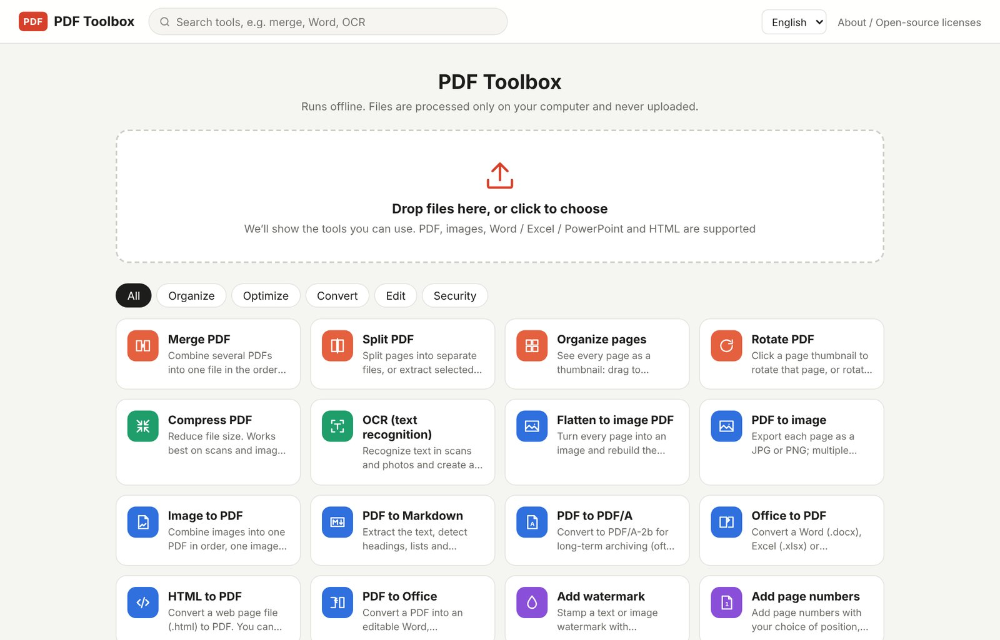
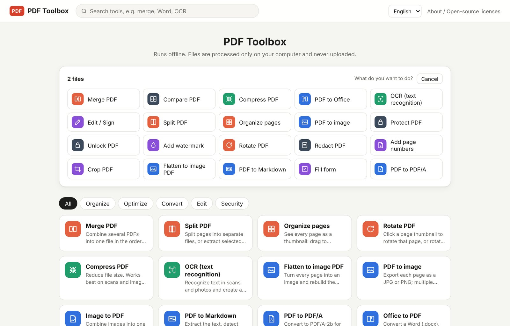
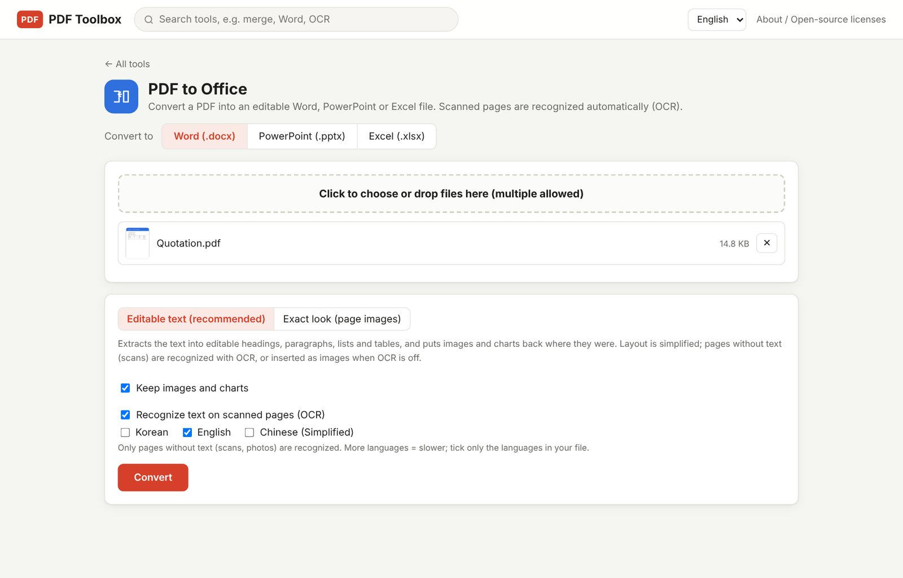

# PDF Toolbox

**An offline PDF converter for Windows and Mac. Merge, split, compress, convert PDF to Word / Excel / PowerPoint, run OCR on scans, sign and password-protect PDFs, all on your own computer. Nothing is ever uploaded.**

[**⬇ Download the latest version**](https://github.com/toolboxnotes/pdf-toolbox/releases/latest) · [Blog post (English)](https://toolboxnotes.com/en/posts/offline-pdf-toolbox/) · [블로그 글 (한국어)](https://toolboxnotes.com/ko/posts/offline-pdf-toolbox/) · [Toolbox Notes](https://toolboxnotes.com/)



## Why

Online PDF converters are convenient, but they ask you to upload contracts, quotes and ID copies to someone else's server. PDF Toolbox does the same jobs inside your browser engine on your own machine:

- **Offline.** Files are processed locally and never leave your computer. It keeps working with Wi-Fi turned off.
- **Nothing to install.** The whole app is one small HTML file. On Windows and Mac a tiny launcher opens it in its own window.
- **23 tools in one place.** The interface is in English, Korean and Chinese.

## Download and run

Go to [Releases](https://github.com/toolboxnotes/pdf-toolbox/releases/latest) and download the file for your computer.

| Platform | File | How to open |
|---|---|---|
| Windows | `PDF-Toolbox-Windows-<version>.zip` | Unzip it and double-click **`PDF Toolbox.exe`**. It opens in its own window using Google Chrome (or Microsoft Edge if Chrome isn't installed), with no address bar or tabs. Keep `PDF Toolbox.exe` and `PDF-Toolbox.html` in the same folder. |
| Mac | `PDF-Toolbox-Mac-<version>.zip` | Unzip it and move **`PDF Toolbox.app`** to Applications. It opens with Chrome, Edge or Brave if installed, otherwise Safari. |
| Anything else | `PDF-Toolbox-<version>.html` | Open the file in Chrome or Edge. |

### First launch warnings

The app is not code-signed yet, so your system will warn you the first time:

- **Windows SmartScreen** ("Windows protected your PC"): click **More info → Run anyway**.
- **macOS** ("cannot be opened because the developer cannot be verified"): **right-click the app → Open**, then confirm.

You only need to do this once.

## Features

| Group | Tools |
|---|---|
| Organize | Merge, Split, Organize pages (reorder, delete, duplicate, insert blank pages), Rotate |
| Optimize | Compress (lossless to strong), OCR (searchable PDF) |
| Convert | PDF to Office (Word, PowerPoint, Excel), Office to PDF, Images to PDF, PDF to images, Flatten to image PDF, PDF to Markdown / TXT, PDF to PDF/A, HTML to PDF |
| Edit | Edit / Sign (text, images, handwritten signature, highlight, white-out), Watermark, Page numbers, Crop, Fill form |
| Security | Protect (AES-256), Unlock (RC4 40/128, AES-128, AES-256), Redact (true removal), Compare |

### How to use

1. **Drop a file** on the big box on the home screen. PDF Toolbox lists the tools that fit (two PDFs put Merge and Compare first; an image suggests Images to PDF).
2. **Pick a tool.** It opens with your file already loaded, and shows page thumbnails so you can check before saving.
3. **Set the options and run.** The result is saved to your Downloads folder. Several output files are zipped together.

You can also search for a tool at the top, or browse by category. Switch the language in the top-right corner; the first time it follows your browser's language.



### Tips

- **White-out is not redaction.** White-out only covers text; the text is still in the file. Use **Redact** (Security) to really remove sensitive information. Redacted pages are turned into images.
- **Compress losslessly first.** The higher compression levels turn pages into images, which shrinks the file a lot but makes text unselectable.
- **PDF to Excel** turns numbers, thousands separators, negatives in parentheses and percentages into real numbers you can calculate with. Scanned pages are recognized automatically (OCR).
- **OCR** supports Korean, English and Simplified Chinese. Choose only the languages your document uses; more languages are slower.



### Known limitations

- Complex documents (many text boxes, charts, multi-column layouts) may look slightly different after conversion to Office.
- OCR can make mistakes on noisy scans or very large headings. Check important results.
- In PowerPoint to PDF, charts and SmartArt are shown as empty boxes.
- Chrome or Edge is recommended. Safari has not been fully tested.

## Building from source

Requires Node.js 18 or later.

```sh
npm install
npm run build
```

The build inlines everything in `src/` together with all third-party libraries, the OCR engine and its language data into a single offline file. Output goes to `dist/`:

- `PDF-Toolbox.html`: the app
- `PDF-Toolbox-Mac.zip`: the Mac app bundle
- `THIRD-PARTY-LICENSES.txt`

The Windows launcher is built separately: run `launcher/windows/build-windows.sh` (needs zig: `pip install ziglang`). It creates `launcher/windows/PDF Toolbox.exe`, which the next `npm run build` copies to `dist/`.

### Project structure

| Path | What it does |
|---|---|
| `src/index.html`, `src/style.css` | Page and styles |
| `src/js/00-i18n.js` | Translations (key = original Chinese text → [English, Korean]) |
| `src/js/01-core.js` | Library loading, helpers, UI components |
| `src/js/02-organize.js` … `05-forms-compare.js` | Organize, convert, edit, forms and compare tools |
| `src/js/06-security.js` | Protect / unlock (own implementation of the PDF standard security handler) |
| `src/js/07-office.js` | PDF to Word / PowerPoint / Excel |
| `src/js/08-pdfa.js` | PDF to PDF/A-2b |
| `src/js/09-office2pdf.js`, `10-ppt2pdf.js` | Word / Excel / PowerPoint to PDF |
| `src/js/11-html2pdf.js` | HTML to PDF |
| `src/js/12-ocr.js` | OCR (Tesseract.js with embedded language data) and the invisible text layer |
| `src/js/13-pdf2office.js` | The combined "PDF to Office" tool |
| `src/js/99-main.js` | Home screen, routing, About / open-source licenses page |
| `launcher/windows/`, `launcher/mac/` | Desktop launchers |

## Feedback

Found a bug or want a feature? [Open an issue](https://github.com/toolboxnotes/pdf-toolbox/issues) or email [toolbox@toolboxnotes.com](mailto:toolbox@toolboxnotes.com). More tools and notes at [toolboxnotes.com](https://toolboxnotes.com/).

## License

Copyright © 2026 Toolbox Notes. All rights reserved. You are free to download and use PDF Toolbox for personal and business work.

PDF Toolbox bundles open-source components (pdf.js, pdf-lib, Tesseract.js, docx, PptxGenJS, JSZip and others) under permissive licenses (MIT, Apache-2.0, BSD and similar). Their full license texts are in [`THIRD-PARTY-LICENSES.txt`](THIRD-PARTY-LICENSES.txt) and in the app under About / Open-source licenses.
